# Android end-to-end journey

The ToDo app on a real Android emulator talking to a real server, driven like a user, with every step
checked on the screen **and** on the server. Generated by `scripts/e2e/android-journey.sh`.

| | |
|---|---|
| **Result** | PASS ✅ |
| **Checks passed** | 41 |
| **Server** | Spring Boot backend, in-memory storage (`http://localhost:8081/api/v1`) |
| **App** | `com.example.todo.local` (debug) on sdk_gphone64_arm64, Android 14 |
| **Run** | 2026-10-21 12:12 UTC, 146s, commit `62efc19` |

Re-run: `make e2e-android` (also `E2E_TARGET=postgres` or `mock`, and `E2E_PUBLISH=1` to refresh this page).

## Setup

- Emulator ready, animations off, app data cleared (`pm clear`), `com.example.todo.local` freshly installed.
- The server starts **empty** (seeding off), so the list holds exactly what this journey creates.

## The journey

Steps 1–12 are the journey as specified. Each ends with the screen and the server's view of the world.

## Step 1 — Start the backend

_Starts the server on port 8081 and empties it._

- ✅ The server answers on http://localhost:8081/api/v1
- ✅ The server starts with no todos

Backend (`GET /todos`):

| Todo | Done | Notes |
|---|---|---|
| _(empty)_ | | |

## Step 2 — Start the Android app

_Launches the app on the emulator._

- ✅ The app is running and shows its empty state
- ✅ Top bar says "0 open"
- ✅ Step 2: the screen shows exactly what the server has ([])

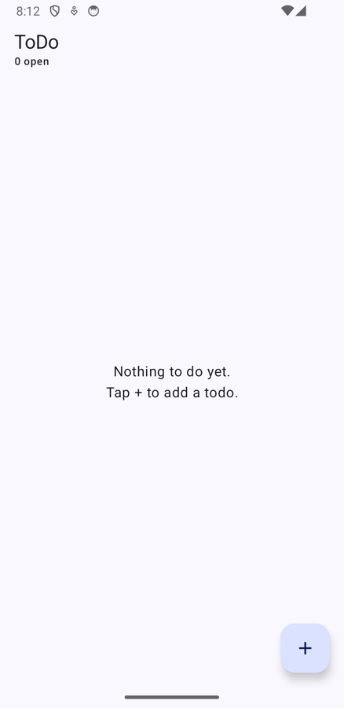

## Step 3 — Create a task: Walk the dog

_Taps +, types the title, taps Save._

- ✅ The server has the todo
- ✅ It starts not completed
- ✅ Top bar says "1 open"

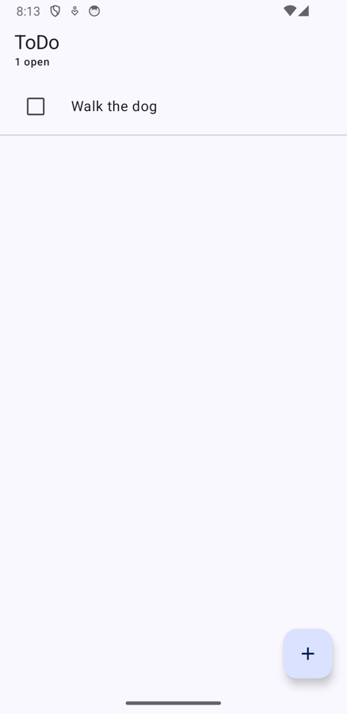

Backend (`GET /todos`):

| Todo | Done | Notes |
|---|---|---|
| Walk the dog | ⬜ |  |

## Step 4 — Create a task: Grocery shopping

_Same again._

- ✅ The server has both, in creation order
- ✅ Step 4: the screen shows exactly what the server has ([{"title":"Walk the dog","completed":false,"notes":null},{"title":"Grocery shopping","completed":false,"notes":null}])
- ✅ Top bar says "2 open"

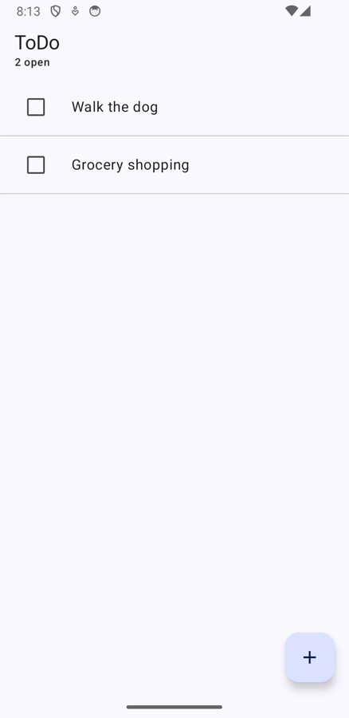

Backend (`GET /todos`):

| Todo | Done | Notes |
|---|---|---|
| Walk the dog | ⬜ |  |
| Grocery shopping | ⬜ |  |

## Step 5 — Complete a task: Walk the dog

_Taps the checkbox next to it._

- ✅ The server marks it completed
- ✅ Grocery shopping is untouched
- ✅ Top bar says "1 open"

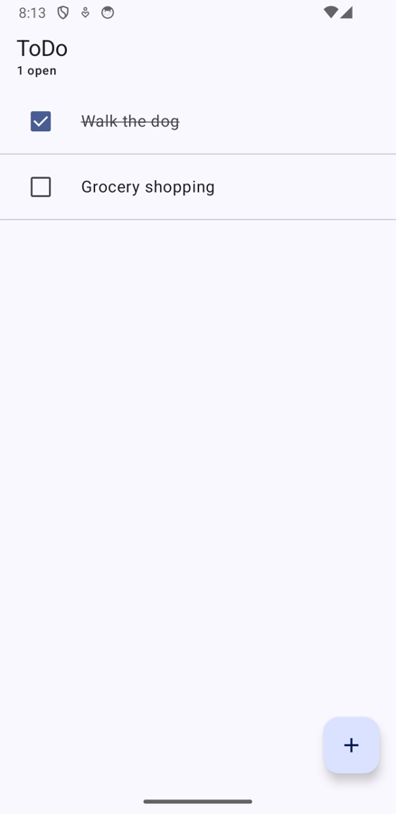

Backend (`GET /todos`):

| Todo | Done | Notes |
|---|---|---|
| Walk the dog | ✅ |  |
| Grocery shopping | ⬜ |  |

## Step 6 — Close the app

_Force-stops the process, so nothing in memory survives._

- ✅ The app process is gone
- ✅ Server-side edit applied while the app is closed

Backend (`GET /todos`):

| Todo | Done | Notes |
|---|---|---|
| Walk the dog | ✅ |  |
| Grocery shopping | ⬜ | Edited on the server while the app was closed |

## Step 7 — Open the app

_Cold start. The state must come from the server._

- ✅ Walk the dog is still completed
- ✅ The note that was added on the server (and never seen by the app) is on screen
- ✅ Step 7: the screen shows exactly what the server has ([{"title":"Walk the dog","completed":true,"notes":null},{"title":"Grocery shopping","completed":false,"notes":"Edited on the server while the app was closed"}])
- ✅ Top bar says "1 open"

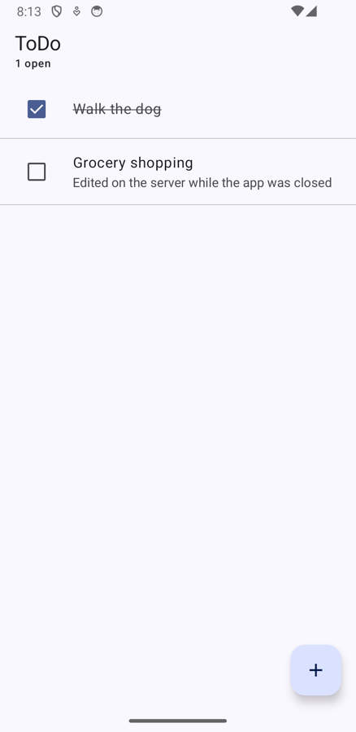

## Step 8 — Delete the Walk the dog task

_Swipes the row away._

- ✅ The server no longer lists it
- ✅ Fetching it by id returns 404
- ✅ Step 8: the screen shows exactly what the server has ([{"title":"Grocery shopping","completed":false,"notes":"Edited on the server while the app was closed"}])

Backend (`GET /todos`):

| Todo | Done | Notes |
|---|---|---|
| Grocery shopping | ⬜ | Edited on the server while the app was closed |

## Step 9 — Complete the Grocery shopping task

_Taps its checkbox._

- ✅ The server marks it completed
- ✅ Top bar says "0 open"

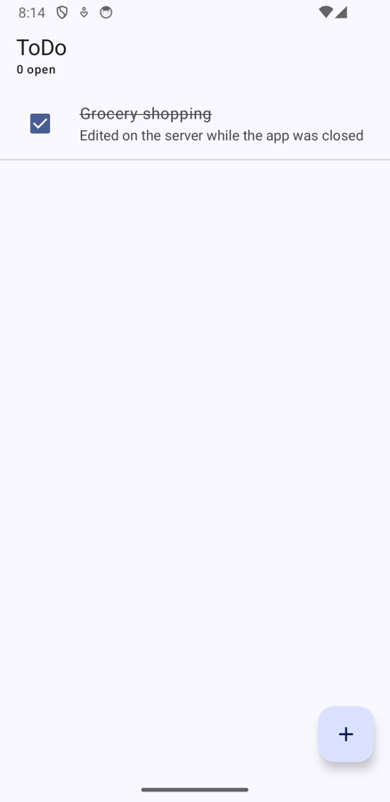

Backend (`GET /todos`):

| Todo | Done | Notes |
|---|---|---|
| Grocery shopping | ✅ | Edited on the server while the app was closed |

## Step 10 — Add a task: Make dinner reservation

_Taps +, types the title, taps Save._

- ✅ The server has both, in creation order
- ✅ The new one is not completed
- ✅ Top bar says "1 open"

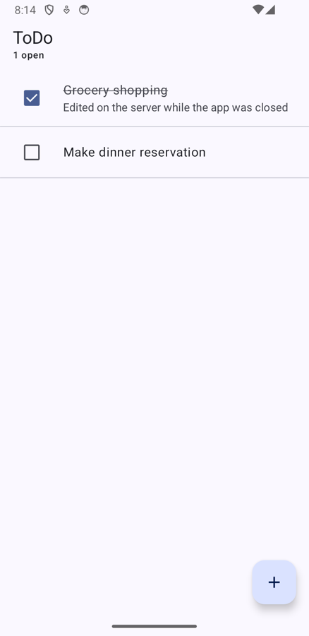

Backend (`GET /todos`):

| Todo | Done | Notes |
|---|---|---|
| Grocery shopping | ✅ | Edited on the server while the app was closed |
| Make dinner reservation | ⬜ |  |

## Step 11 — Close the app

_Force-stops it again, then edits the server behind its back._

- ✅ The app process is gone
- ✅ Server-side edit applied while the app is closed

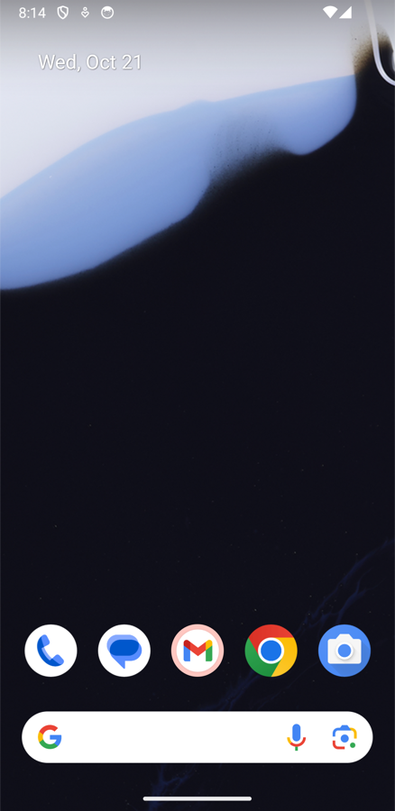

Backend (`GET /todos`):

| Todo | Done | Notes |
|---|---|---|
| Grocery shopping | ✅ | Edited on the server while the app was closed |
| Make dinner reservation | ⬜ | Table for two at 7pm |

## Step 12 — Open the app

_Cold start. Final state must match the server._

- ✅ The server-side note is on screen
- ✅ Grocery shopping is completed
- ✅ Make dinner reservation is still open
- ✅ Walk the dog stays deleted
- ✅ Step 12: the screen shows exactly what the server has ([{"title":"Grocery shopping","completed":true,"notes":"Edited on the server while the app was closed"},{"title":"Make dinner reservation","completed":false,"notes":"Table for two at 7pm"}])
- ✅ Top bar says "1 open"

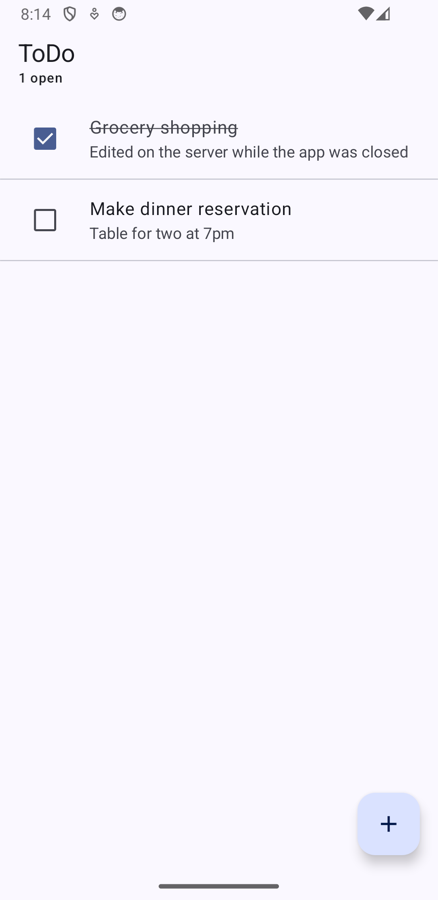

Backend (`GET /todos`):

| Todo | Done | Notes |
|---|---|---|
| Grocery shopping | ✅ | Edited on the server while the app was closed |
| Make dinner reservation | ⬜ | Table for two at 7pm |

## Extra: the server goes away

Not part of the original journey. Checks that the app fails gracefully and recovers on its own.

- ✅ Backend stopped: connections are refused
- ✅ A refresh failure is reported in a snackbar
- ✅ The list stays on screen instead of being wiped

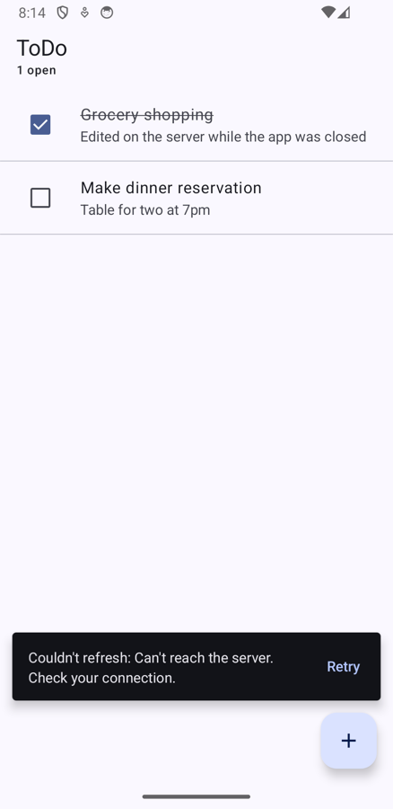

- ✅ The server is back
- ℹ️ The in-memory backend lost its data when it restarted, so it is empty now. That is expected for this profile.
- ✅ After one more pull to refresh the screen matches the server again

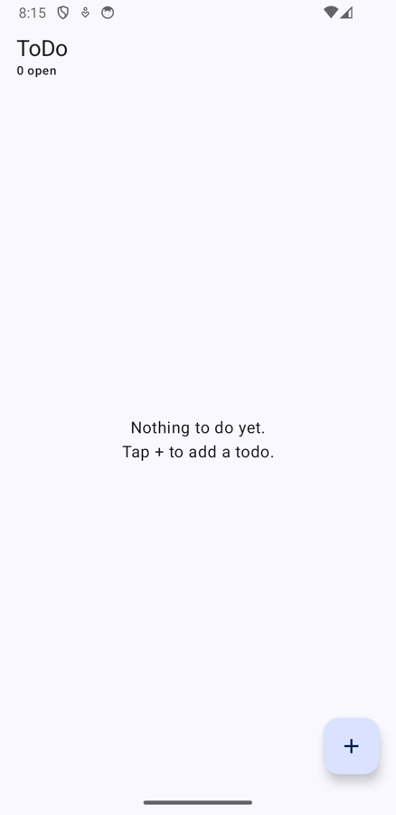

Backend (`GET /todos`):

| Todo | Done | Notes |
|---|---|---|
| _(empty)_ | | |

## Result

Every check above passed.

